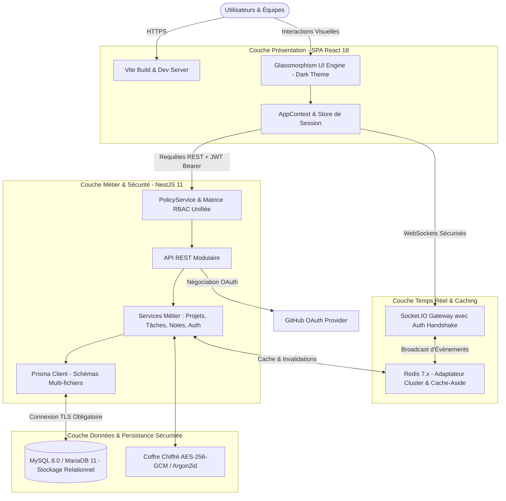

<div align="center">

# ⚡ Planner-Pro

### _La plateforme collaborative de planification stratégique, d'exécution agile et de gouvernance d'entreprise._

**Conçu & développé par la startup INTERACT**

[](https://planner-pro.boukarou-os.com)
[-blueviolet?style=for-the-badge&logo=shield>)](docs/security/rapport-audit.md)
[](https://www.typescriptlang.org/)
[](https://react.dev/)
[](https://nestjs.com/)
[](https://www.mysql.com/)
[](https://redis.io/)
[](https://www.docker.com/)

<p align="center">
  <b>La solution tout-en-un pensée pour les organisations, les entreprises et les porteurs de projet qui exigent un suivi optimal, une concentration totale et une gouvernance sans compromis.</b>
</p>

[Vision & Objectifs](#-vision--objectifs-du-projet) • [Fonctionnalités](#-fonctionnalités-clés) • [Architecture Système](#-architecture-technique-de-planner-pro) • [Sécurité Entreprise](#--sécurité--conformité-entreprise) • [Déploiement](#--démarrage-rapide-en-production) • [Documentation](#-documentation-technique)

---

</div>

## 🎯 Vision & Objectifs du Projet

Imaginé et conçu par la startup **Interact**, **Planner-Pro** répond à une problématique centrale rencontrée par les organisations en croissance et les porteurs de projet : **la déperdition de temps et d'alignement causée par la prolifération d'outils disparates**.

### Les Cibles & Bénéfices

- **Pour les Entreprises & Organisations** :
  - Gouvernance multi-espaces étanche pour structurer directions, équipes métiers et filiales.
  - Souveraineté intégrale des données (auto-hébergement on-premise ou cloud dédié, aucun enfermement propriétaire).
  - Traçabilité, conformité et respect strict des politiques de sécurité d'entreprise (RBAC, MFA, sessions supervisées).
- **Pour les Porteurs de Projet & Managers** :
  - **Suivi optimal et unifié** : Rapprochement automatique entre la feuille de route (Gantt), les tâches opérationnelles (Kanban), la capacité de l'équipe et le temps réel passé.
  - Détection préventive des goulets d'étranglement grâce à des métriques de santé de projet et à l'anti-blocage algorithmique.
- **Pour les Équipes & Collaborateurs** :
  - Élimination du bruit mental : un espace unique combinant prise de notes intelligentes, time-blocking et minuteurs de concentration (Pomodoro).

---

## 🚀 Fonctionnalités Clés

### 📊 1. Tableaux de Bord Exécutifs & Métriques de Portefeuille

- **Santé de Projet Dynamique** : Indicateur calculé en continu selon le respect des jalons, le ratio de tâches en retard et la cadence de livraison.
- **Pilotage de la Capacité** : Visualisation prévisionnelle de la disponibilité des équipes, des congés et de l'allocation des compétences.
- **Vue Quotidienne Unifiée** : Agenda consolidé du jour avec échéances prioritaires et blocs horaires réservés.

### 📋 2. Gestion de Projet Hybride : Kanban & Gantt Prédictif

- **Kanban Fluide** : Glisser-déposer instantané, hiérarchie de priorités, étiquettes contextuelles et estimations d'effort.
- **Diagramme de Gantt avec Anti-Cycle (DFS)** : Modélisation des dépendances réelles avec détection de cycles par parcours en profondeur pour interdire les inter-blocages de plannings.
- **Jalons & Livrables** : Suivi des étapes contractuelles avec validation de conformité par les administrateurs de projet.

### ⏱️ 3. Time-Blocking & Focus Pomodoro Synchronisé

- Planification par blocs de temps directement connectée aux tâches Kanban.
- **Minuteur Pomodoro temps réel** : Synchronisation multi-appareils via WebSockets (Socket.IO + adaptateur Redis).
- Audit des temps consommés : Historique exploitable pour l'analyse de rentabilité et la facturation.

### 📝 4. Prise de Notes Intelligente & Markdown Contextuel

- Éditeur Markdown ergonomique avec sauvegarde instantanée et rendu sans latence.
- **Auto-Parsing de Tâches** : Vos notes de réunions génèrent automatiquement des tâches exploitables dans le Kanban (avec isolation stricte des blocs de code).
- Système de cache chaud Redis (_Cache-Aside_) assurant des temps de lecture inférieurs à 10 millisecondes.

### 🏢 5. Espaces de Travail Multi-Tenants & Rôles Hiérarchiques

- Cloisonnement absolu entre clients, départements et projets.
- **Double niveau de RBAC** : Rôles d'espace de travail (`OWNER`, `ADMIN`, `MEMBER`, `VIEWER`) et rôles de projet (`MANAGER`, `CONTRIBUTOR`, `CLIENT`).
- Liens et invitations nominatives sécurisées par signatures cryptographiques à usage unique.

---

## 🏗 Architecture Technique de Planner-Pro

L'architecture de Planner-Pro repose sur les principes de la **Clean Architecture**, du **Domain-Driven Design (DDD)** et du modèle de sécurité **Zero-Trust** :



### Découpage en Couches

1. **Couche Présentation (Frontend)** :
   - Développée en **React 18** avec **TypeScript** et **Vite**.
   - Design System propriétaire fondé sur le **Glassmorphism Dark Theme** : minimisation de la fatigue oculaire, contrastes WCAG 2.1 AA et animations d'état à 60 fps.
2. **Couche Collaboration Temps Réel (WebSockets)** :
   - Passerelle **Socket.IO** intégrée à NestJS avec vérification cryptographique dès la poignée de main (_handshake_).
   - Adaptateur Redis pour supporter la distribution horizontale sur plusieurs conteneurs d'API.
3. **Couche Métier & Sécurité Centrale (Backend API)** :
   - Framework **NestJS 11** (Express 5, Node 22) en TypeScript strict. Le déploiement en production est continu (push sur `main`, CI, approbation, script de déploiement) : voir [docs/deployment-production.md](docs/deployment-production.md).
   - Service d'autorisation centralisé (`PolicyService`) s'appuyant sur une matrice de permissions déclarative unique ([permissions.ts](file:///home/gaetan/Documents/GitHub/planner-pro/backend/src/authz/permissions.ts)) interdisant formellement les failles IDOR/BOLA.
4. **Couche Données & Chiffrement (Data & Security Vault)** :
   - **Prisma ORM** avec modularisation du modèle de données (`backend/prisma/schema/`).
   - Base de données **MySQL 8.0 / MariaDB 11** durcie avec transport sécurisé TLS obligatoire en production (`DATABASE_SSL=true`).
   - Chiffrement symétrique **AES-256-GCM** avec vecteur d'initialisation et tag d'intégrité pour tous les secrets et jetons tiers stockés.

---

## 🛡️ Sécurité & Conformité Entreprise

Planner-Pro intègre les exigences de sécurité dès la conception (_Security by Design_). Le projet applique le programme de remédiation audité par notre architecte sécurité (**conrado**) :

| Domaine de Sécurité                     | Spécification Technique Planner-Pro                                                                                                      | Impact & Conformité                                                                          |
| :-------------------------------------- | :--------------------------------------------------------------------------------------------------------------------------------------- | :------------------------------------------------------------------------------------------- |
| **Authentification Double Facteur**     | **MFA TOTP** standard (Google Authenticator, Bitwarden, etc.) + 10 codes de secours à usage unique hachés.                               | Obligatoire pour les administrateurs de plateforme. Immunité contre le vol de mot de passe.  |
| **Isolation Multi-Tenant (Anti-IDOR)**  | Scoping systématique par `workspaceId` et validation de la politique d'accès avant toute opération de base de données.                   | Étanchéité absolue des données entre clients et projets distincts.                           |
| **Console d'Administration Supervisée** | Sessions administrateur plafonnées à 12 h, révocation immédiate en 1 clic et motif obligatoire consigné (`reason`) pour l'impersonation. | Respect des normes d'audit interne, de gouvernance et traçabilité des opérations de support. |
| **Hachage & Chiffrement de Pointe**     | Mots de passe protégés par **Argon2id** (résistant aux attaques GPU/ASIC) et clés d'intégration chiffrées en **AES-256-GCM**.            | Données illisibles et protégées contre l'exfiltration même en cas de dump de base.           |
| **Résilience d'Exploitation**           | Sauvegardes automatisées chiffrées par clé GPG (`planner-pro-backup.service`), fail-fast au boot et arrêt sécurisé.                      | Continuité d'activité (PCA/PRA) garantie pour les environnements de production.              |

---

## ⚡ Démarrage Rapide en Production

Le déploiement de Planner-Pro est conteneurisé de bout en bout pour garantir une mise en service en moins de 5 minutes.

### 1. Prérequis Système

- Serveur Linux (Ubuntu 22.04 / 24.04 recommandé)
- **Docker Engine** >= 24.x et **Docker Compose** >= 2.x
- Clé d'application OAuth GitHub (optionnelle, pour l'authentification développeur)

### 2. Configuration Initiale

```bash
git clone https://github.com/Gaetan5/planner-pro.git
cd planner-pro

# Copier le template d'environnement de production
cp .env.production.example .env.production
```

> [!IMPORTANT]
> Définissez des clés aléatoires fortes dans votre `.env.production` : `JWT_SECRET`, `ENCRYPTION_KEY` (32 octets hexadécimaux), ainsi que les mots de passe de base de données.

### 3. Lancement des Conteneurs

```bash
docker compose --env-file .env.production -f docker-compose.prod.yml up -d --build
```

L'orchestrateur Docker prend en charge la séquence complète :

1. Démarrage de MySQL et Redis avec healthchecks actifs.
2. Attente de disponibilité réseau via `wait-for-db.js`.
3. Application automatique des migrations de schéma Prisma.
4. Lancement du cluster backend NestJS et du serveur Nginx de production.

- **Interface Web** : `http://votre-domaine.com` (ou port 80 local)
- **API REST & WebSockets** : `http://votre-domaine.com:3001`
- **Health Check API** : `GET http://votre-domaine.com:3001/health`

---

## 💻 Environnement de Développement Local

Pour les contributeurs et développeurs de l'équipe :

```bash
# 1. Installer les dépendances du monorepo pnpm
pnpm install

# 2. Démarrer les services d'infrastructure (DB & Redis)
docker compose up -d db cache

# 3. Synchroniser le schéma Prisma avec la base locale
cd backend && pnpm exec prisma db push

# 4. Lancer les applications en mode Watch (HMR)
pnpm dev
```

### Suites de Tests & Assurance Qualité

```bash
# Tests unitaires et d'intégration backend (>2360 tests, 81 suites)
cd backend && pnpm test

# Tests frontend Vitest (composants, session, sécurité)
cd frontend && pnpm test:run

# Vérification du typage et des linters
pnpm lint && pnpm build
```

---

## 📚 Documentation Technique & Références

- **[Dossier d'Architecture Technique (DAT)](docs/DOSSIER_ARCHITECTURE_TECHNIQUE.md)** : Spécifications détaillées, modélisation des entités et flux d'ingénierie.
- **[Rapport d'Audit de Sécurité](docs/security/rapport-audit.md)** : Registre des 45 constats de sécurité et critères de validation (par l'architecte conrado).
- **[Journal de Bord des Corrections](docs/security/journal-corrections.md)** : Journal d'implémentation TDD avec preuves de tests (par l'agent senior fixer).
- **[Matrice d'Autorisation RBAC](docs/security/matrice-rbac.md)** : Grille exhaustive des rôles et des permissions par ressource.

---

<div align="center">
  <p><b>Planner-Pro</b> est un produit développé et propulsé par <b>INTERACT</b>.</p>
  <p>© 2026 INTERACT. Conçu pour l'excellence opérationnelle, la performance collective et la souveraineté numérique des organisations.</p>
</div>
